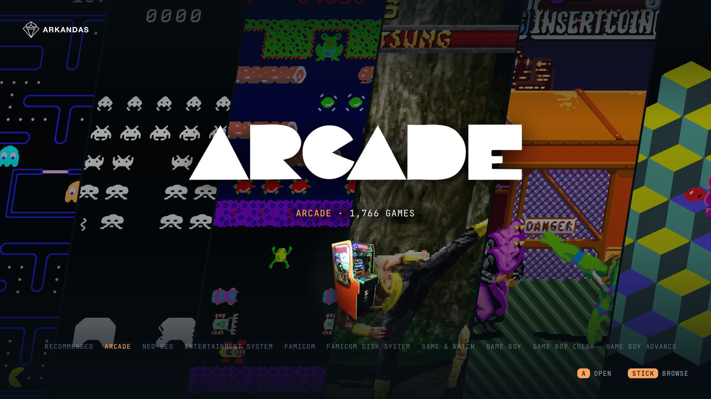
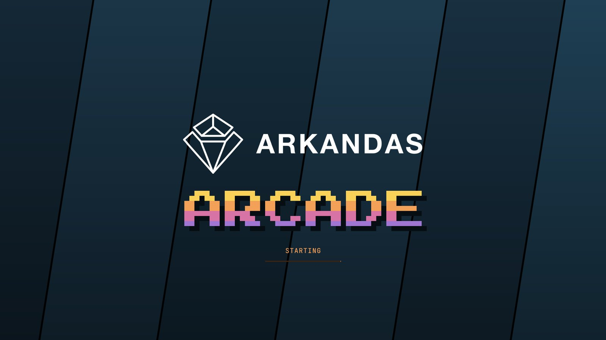
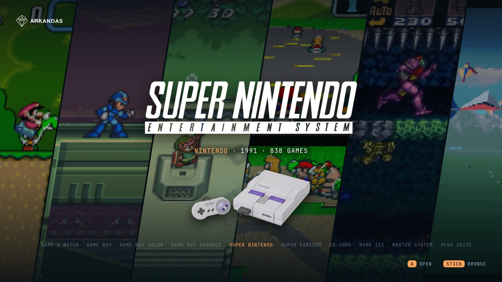
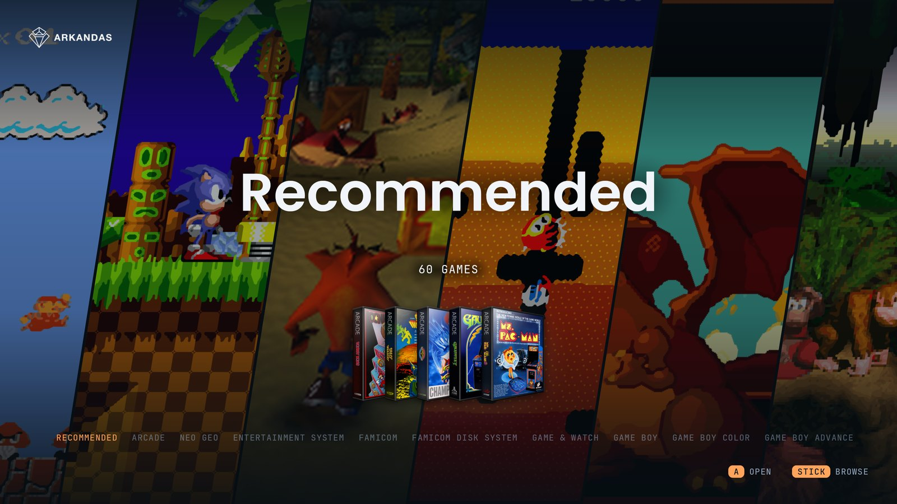
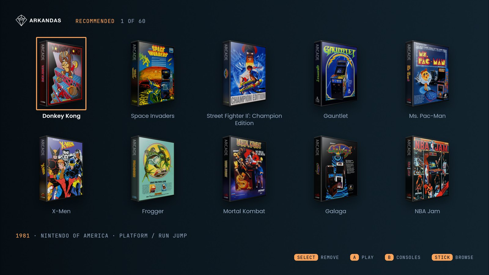
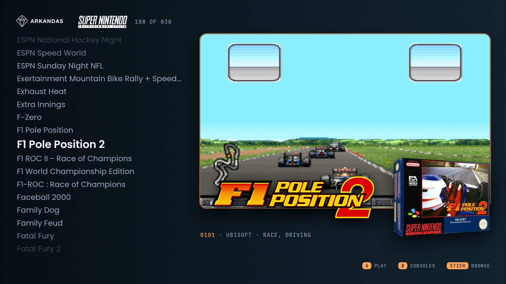
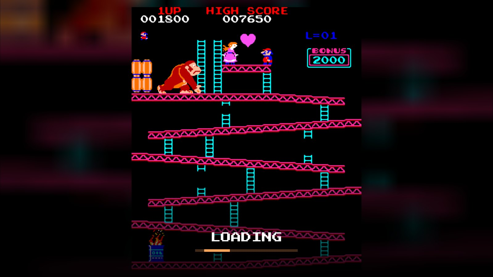
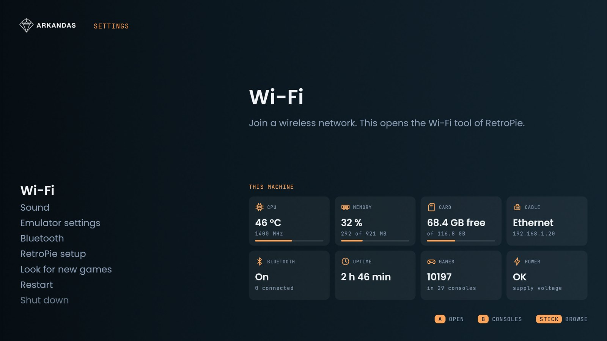
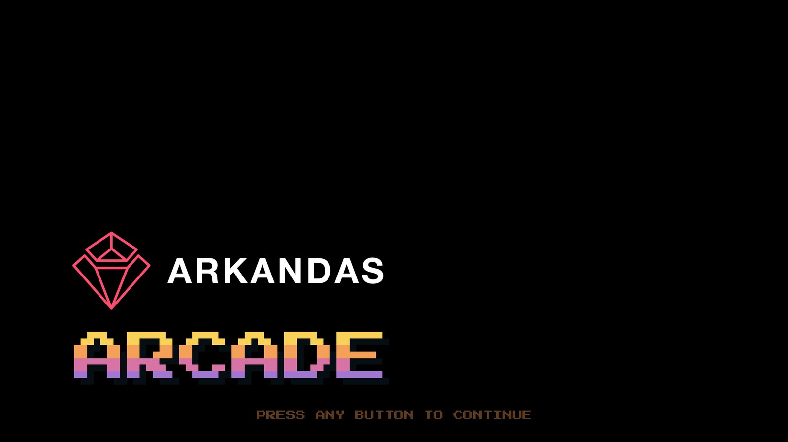
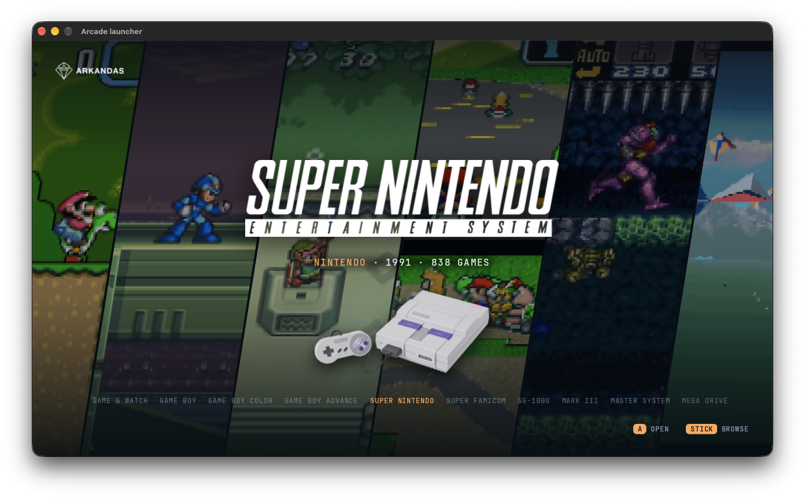

# Arcade launcher



Arcade launcher is a custom front end for RetroPie 4.8.12, built for arcade cabinets with a Raspberry Pi 3B+. It replaces the RetroPie splash screen and EmulationStation, the default RetroPie interface. The installation also handles the system setup, including RetroArch, GPIO controls, the power button and emulators missing from the original RetroPie image.

## Screens

| | |
| --- | --- |
|  |  |
| Start animation | Console screen |
|  |  |
| Recommended | Recommended games |
|  |  |
| Game list | Loading screen |
|  |  |
| Settings | Screensaver |

## Controls

| Action | Cabinet | Gamepad | Keyboard |
| --- | --- | --- | --- |
| Move | Stick | D-pad or left stick | Arrow keys |
| Open or play | Y | A | Enter |
| Back | L | B | Esc |
| Next console or letter | R or stick right | D-pad right | Right arrow |
| Previous console or letter | X or stick left | D-pad left | Left arrow |
| Add to Recommended | Select | Select | Right Shift |
| Remove from Recommended | Select twice | Select twice | Right Shift twice |
| Quit to the terminal | | | F4 |
| Switch the Pi off or on | Power button | | |

| In a game | Action |
| --- | --- |
| Select + A, twice | Quit the game |
| Select + X | Pause |
| Select + R | Save the state |
| Select + L | Load the state |
| Select + left or right | Change the state slot |
| Select + up or down | Change the shader |
| Start + Select | Open the RetroArch menu |

Each game resumes from the state saved at the last quit.

## Installation

### Requirements

- Raspberry Pi 3B+
- microSD card of 8 GB plus the size of the games
- Network connection for the Pi during the installation
- Computer with a card reader and [Raspberry Pi Imager](https://www.raspberrypi.com/software/)
- Gamepad or sticks wired as in [hardware/README.md](hardware/README.md)

### 1. Write RetroPie to the card

1. Download [retropie-bookworm-4.8.12-rpi3_zero2w.img.xz](https://files.retropie.org.uk/images/weekly/retropie-bookworm-4.8.12-rpi3_zero2w.img.xz)
2. Write the image to the card with Raspberry Pi Imager (Choose OS, Use Custom)
3. Create an empty file named `ssh` on the boot partition of the card
4. Start the Pi from the card with a network cable connected

To use Wi-Fi in place of the cable, quit EmulationStation with F4 on a keyboard plugged into the Pi. Then run `sudo ~/RetroPie-Setup/retropie_setup.sh` to connect to the network with the wifi tool under Configuration / tools.

### 2. Install the launcher

Log in to the Pi with `ssh pi@retropie.local` (password `raspberry`).

```
git clone https://github.com/arkandas/arcade-launcher.git
cd arcade-launcher
./setup.sh
```

The installation takes about 14 minutes on a Pi 3B+. On a Pi with gamepads in place of GPIO sticks, run `./setup.sh --no-gpio`.

### 3. Add games

Copy the games into the folders listed in [Games and emulators](#games-and-emulators), for example with `rsync -a nes/ pi@retropie.local:RetroPie/roms/nes/`. BIOS files go into `~/RetroPie/BIOS/`. After copying, choose Look for new games in Settings.

### Update

```
cd ~/arcade-launcher
git pull
./setup.sh
```

<details>
<summary>Changes to the card</summary>

| File | Change |
| --- | --- |
| `/opt/retropie/configs/all/autostart.sh` | `arcade.sh` in place of `emulationstation #auto` |
| `launcher-boot.service`, `/etc/initramfs-tools/hooks/launcher-boot`, `/etc/initramfs-tools/scripts/init-top/launcher-boot` | Start animation and graphics driver in the initramfs, previous initramfs in `/boot/firmware/initramfs7.before-launcher` |
| `asplashscreen.service` | Disabled |
| `/opt/retropie/configs/all/runcommand.cfg` | `disable_menu = "1"`, `disable_joystick = "1"` |
| `/opt/retropie/configs/all/retroarch.cfg` | Hotkeys, stick and menu buttons, saved states at quit and start, picture and bezel settings, CRT shader folder |
| `/opt/retropie/configs/<handheld>/retroarch.cfg` | Aspect ratio of the handheld consoles |
| `/opt/retropie/configs/segacd/retroarch.cfg` | Six-button pads |
| `/opt/retropie/configs/all/retroarch-core-options.cfg` | `mame2003_skip_warnings = "enabled"`, six-button pads in PicoDrive, `mame2003-plus_mame_remapping = "disabled"` |
| `/boot/firmware/config.txt` | `dtoverlay=gpio-shutdown` |
| `/boot/firmware/cmdline.txt` | `quiet loglevel=2 logo.nologo vt.global_cursor_default=0 consoleblank=0 usbhid.quirks=0x16c0:0x05e1:0x040`, `console=tty3` in place of `console=tty1`, previous line in `cmdline.txt.before-launcher` |
| `~/.hushlogin`, drop-in for `getty@tty1` | Silent login |
| `/etc/modules`, `/etc/modprobe.d/mk_arcade_joystick_rpi.conf` | Stick driver with `map=1,2` |

#### Undo

1. Write `emulationstation #auto` into `/opt/retropie/configs/all/autostart.sh`
2. Run `sudo systemctl disable launcher-boot` and `sudo systemctl enable asplashscreen`
3. Restart the Pi

If the Pi fails to boot after an installation, copy `initramfs7.before-launcher` over `initramfs7` on the boot partition of the card.

</details>

## Games and emulators

| Console | Maker | Folder in `~/RetroPie/roms` |
| --- | --- | --- |
| Arcade | Various | `arcade` and `fba` (lr-fbneo), `mame-libretro` |
| Neo Geo | SNK | `neogeo` (lr-fbneo) |
| Entertainment System | Nintendo | `nes` |
| Famicom | Nintendo | `famicom` |
| Famicom Disk System | Nintendo | `fds` |
| Game & Watch | Nintendo | `gameandwatch` |
| Game Boy | Nintendo | `gb` |
| Game Boy Color | Nintendo | `gbc` |
| Game Boy Advance | Nintendo | `gba` |
| Super Nintendo | Nintendo | `snes` |
| Super Famicom | Nintendo | `sfc` |
| SG-1000 | Sega | `sg-1000` |
| Mark III | Sega | `markiii` |
| Master System | Sega | `mastersystem` |
| Mega Drive | Sega | `megadrive` |
| Mega Drive Japan | Sega | `megadrive-japan` |
| Mega-CD | Sega | `segacd` |
| 32X | Sega | `sega32x` |
| Game Gear | Sega | `gamegear` |
| TurboGrafx-16 | NEC | `tg16` |
| PC Engine | NEC | `pcengine` |
| SuperGrafx | NEC | `supergrafx` |
| PlayStation | Sony | `psx` |
| Neo Geo Pocket | SNK | `ngp` |
| Neo Geo Pocket Color | SNK | `ngpc` |
| WonderSwan | Bandai | `wonderswan` |
| WonderSwan Color | Bandai | `wonderswancolor` |
| Atari 2600 | Atari | `atari2600` |
| Atari 7800 | Atari | `atari7800` |

Games in the folders marked lr-fbneo need FinalBurn Neo ROM sets. Per-game emulator choices go into `/opt/retropie/configs/all/emulators.cfg`.

| Picture | Folder next to the games |
| --- | --- |
| Box | `boxart/` |
| Screenshot | `snap/` |
| Logo | `wheel/` |

Each picture is a PNG file named after the game file. On the Pi, `python3 -I ~/arcade-launcher/tools/fill_pictures.py` downloads missing boxes and screenshots from [libretro-thumbnails](https://github.com/libretro-thumbnails). Game details come from scraped `gamelist.xml` files in the game folder or in `~/.emulationstation/gamelists/<folder>/`. New pictures and game details appear after Look for new games in Settings.

USB and Bluetooth gamepads in the SDL controller database work in the menu and in the games. The button mapping of the GPIO controls is in `controllers.json`.

### Bezels (optional)

[The Bezel Project](https://github.com/thebezelproject/BezelProject) installs bezel packs on the Pi.

```
cd ~/RetroPie/retropiemenu
wget https://raw.githubusercontent.com/thebezelproject/BezelProject/master/bezelproject.sh
chmod +x bezelproject.sh
./bezelproject.sh
```

Choose the packs in the installer menu.

### Games from another RetroPie card

`tools/copy_library.py` copies the games and game settings of another RetroPie card to the Pi. The script runs on a computer, after `setup.sh` on the Pi.

```
python3 -I tools/copy_library.py SOURCE_ROOT pi@retropie.local
```

`SOURCE_ROOT` is a folder with the files of the source card.

## Text and logos

| Change | File |
| --- | --- |
| Cabinet name | `name` in `brand/brand.json` |
| Colours | `colours` in `brand/brand.json` |
| Logo | `brand/logo.svg`, drawn in white |
| Console names, makers, years and order | `consoles.json` |
| Console logos | RetroPie theme carbon-2021 on the card, `assets/logos/<folder>.svg` for the rest |
| Console photos | `assets/consoles/<folder>.png` |
| Strip pictures of the console screens | `strips.json` |
| First games of Recommended | `recommended.json` |
| ARCADE, STARTING, LOADING, PRESS ANY BUTTON TO CONTINUE | `tools/build_assets.py` |
| Settings entries | `SETTINGS` in `frontend/main.cpp` |

`./setup.sh` on the Pi or `tools/deploy.sh` on a computer applies the changes.

## Development

| Folder | Contents |
| --- | --- |
| `frontend/` | Menu (`main.cpp`), start animation (`boot.c`, `looks.c`) and loading bar (`loading.c`) in C and C++ with SDL2 and OpenGL ES 2 |
| `pi/` | `arcade.sh`, `install.sh`, `make_library.py` |
| `tools/` | `build_assets.py`, `make_strips.py`, `fill_pictures.py`, `copy_library.py`, `deploy.sh` |
| `brand/` | Name, colours and logo |
| `assets/` | Fonts and console pictures |
| `mac/` | Menu preview for macOS ([mac/README.md](mac/README.md)) |
| `hardware/` | Wiring of the cabinet controls |
| `layouts/` | Button remaps, emulator settings and emulator choices that `copy_library.py` installs for the games of the source card |

| Program on the Pi | Job |
| --- | --- |
| `arcade.sh` | Menu loop on tty1, start of games and tools |
| `launcher` | Menu |
| `launcher-boot` | Start animation, from the initramfs on |
| `launcher-load` | Loading bar while a game or tool starts |

### Mac preview



`mac/run.sh` runs the menu in a macOS window with the game list and pictures of a Pi on the network.

```
cd mac
./run.sh
```

The keys match the Keyboard column of [Controls](#controls). Games and RetroPie tools run on the Pi. The terminal shows the name of the chosen game or tool. [mac/README.md](mac/README.md) lists the requirements and settings of the preview.

### Deploy from a computer

`tools/deploy.sh pi@retropie.local` installs the working copy on the Pi over SSH. The computer needs rsync and rsvg-convert, plus Python 3 with Pillow, numpy and scipy.

### Development files

`touch /dev/shm/launcher-dev; sudo systemctl restart getty@tty1` turns on the development files of the menu in `/dev/shm`.

| File in `/dev/shm` | Use |
| --- | --- |
| `launcher-shot-request` | Screenshot request, answered in `launcher-shot.ppm` |
| `launcher-dev-keys` | Button presses as words, such as `up a select` |
| `launcher.log` | Frame times |
| `launcher.err` | Errors of the menu |

## Licence

The code and documentation are under the [MIT licence](LICENSE). [CREDITS.md](CREDITS.md) lists the licences of the fonts and pictures in `assets/`. The Arkandas logo in `brand/logo.svg` belongs to Arkandas.
